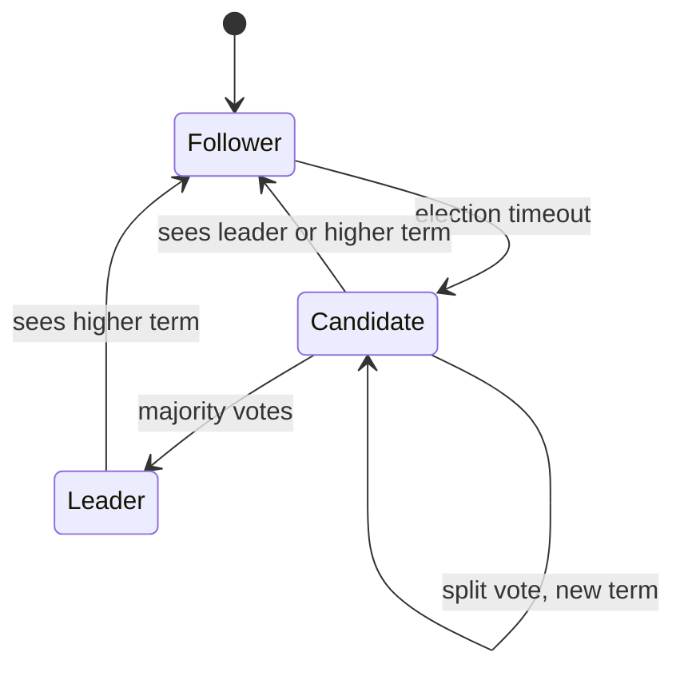

## 개요

[앞 글](/posts/cs/distributed/consistency-models-quorum)에서는 과반 쿼럼이 왜 읽기와 쓰기를 겹치게 만드는지 봤다. [복제 글](/posts/cs/distributed/replication-cap-pacelc)에서는 리더 하나가 쓰기 순서를 정하는 리더 기반 복제를 봤다. 남은 질문은 "그 리더를 누가, 어떻게 안전하게 바꾸는가"다.

이 글이 답하는 질문은 두 가지다.

- 리더가 죽었을 때 Raft는 어떻게 새 리더를 하나만 뽑고, 이미 커밋된 쓰기를 잃지 않는가?
- 네트워크가 일부만 끊기는 부분 장애에서는 무엇이 꼬이고, PreVote와 CheckQuorum은 그것을 어떻게 막는가?

---

## 1. 합의가 필요한 이유

리더 기반 복제는 평소에는 단순하다. 리더가 쓰기를 받아 순서를 정하고, 팔로워가 그 순서대로 따라 적용한다. 문제는 리더가 죽었을 때다.

노드 3대(A, B, C)가 있고 A가 리더라고 하자. A가 `x = 5`를 쓰고 B에만 복제한 직후 죽었다. 이제 누군가가 새 리더를 정해야 한다.

- C를 리더로 올리면 `x = 5`는 사라진다. 클라이언트가 이미 성공 응답을 받았다면 확정된 쓰기를 잃은 것이다.
- 네트워크가 잠깐 끊긴 것뿐이고 A가 살아 있었다면, A와 새 리더가 동시에 쓰기를 받는다. 이것을 split-brain이라고 한다. 리더가 둘이 되어 데이터가 갈라지는 상태다.

결국 "지금 리더가 누구인가"와 "어떤 쓰기가 확정됐는가"를 모든 노드가 똑같이 알아야 한다. 이것이 합의(consensus) 문제다. 합의는 여러 노드가 일부 장애와 메시지 지연 속에서도 하나의 값, 여기서는 같은 순서의 같은 로그에 동의하는 문제다.

로그 순서에 합의하면 나머지는 따라온다. 같은 초기 상태에서 같은 명령을 같은 순서로 적용하면 모든 노드가 같은 상태가 된다. 이 구조를 복제 상태 기계(replicated state machine)라고 한다. Raft는 이 로그를 맞추는 알고리즘이다.

핵심 아이디어는 한 문장이다. **과반(majority)이 동의한 것만 확정으로 친다.** 과반 둘은 반드시 한 노드 이상 겹치므로, 서로 모르는 두 결정이 동시에 확정될 수 없다.

과반으로 결정하므로 견딜 수 있는 장애 수는 노드 수로 정해진다.

| 노드 수 N | 과반 | 견디는 장애 수 |
|---|---|---|
| 3 | 2 | 1 |
| 4 | 3 | 1 |
| 5 | 3 | 2 |
| 7 | 4 | 3 |

$f$대 장애를 견디려면 $2f+1$대가 필요하다. 4대는 3대와 견디는 장애 수가 같고 복제 대상만 하나 늘어난다. 그래서 합의 그룹은 보통 3대나 5대로 짝수를 피한다.

Raft는 Paxos보다 이해하기 쉽게 만드는 것을 목표로 설계됐다. 그래서 문제를 리더 선출, 로그 복제, 안전성 셋으로 나눈다. 이 글도 그 순서를 따른다.

---

## 2. 역할과 term

리더가 바뀌는 과정에서는 "옛 리더"와 "새 리더"가 잠깐 공존할 수 있다. 노드끼리 어느 쪽이 더 최신인지 판단할 기준이 필요하다.

Raft의 답은 term이다. term은 1, 2, 3처럼 단조 증가하는 번호로, 시간을 "선거 한 번과 그 뒤의 임기" 단위로 나눈다. 일종의 논리 시계다. 한 term에는 리더가 최대 한 명이다. 선거가 실패하면 리더 없이 끝나는 term도 있다.

각 노드는 세 역할 중 하나다.

- 팔로워(follower): 리더의 요청에 응답만 한다. 처음 시작하면 모두 팔로워다.
- 후보(candidate): 리더 소식이 끊겨 선거에 나선 노드다.
- 리더(leader): 클라이언트 쓰기를 받아 로그에 넣고 팔로워에게 복제한다.



term에 관한 규칙은 두 개뿐이다.

1. 노드끼리 주고받는 모든 메시지에 term이 붙는다. 상대 term이 더 크면 자기 term을 그 값으로 올린다. 후보나 리더였다면 즉시 팔로워로 내려간다.
2. 자기보다 작은 term이 붙은 요청은 거부한다.

이 두 규칙으로 옛 리더 문제가 풀린다. term 3의 리더가 네트워크에서 끊겼다가 돌아왔다고 하자. 그동안 다른 쪽은 term 4의 리더를 뽑았다. 옛 리더가 보내는 term 3 요청은 거부되고, 옛 리더는 응답에 실린 term 4를 보고 팔로워로 내려간다.

Raft의 기본 동작에 필요한 RPC는 두 종류다.

| RPC | 보내는 쪽 | 용도 |
|---|---|---|
| `RequestVote` | 후보 | 선거에서 표를 요청한다 |
| `AppendEntries` | 리더 | 로그 항목을 복제한다. 항목 없이 보내면 heartbeat 역할을 한다 |

---

## 3. 리더 선출: 타임아웃, 투표, 랜덤 타임아웃

리더가 죽었다는 것을 누가, 언제 알아차리는가? 분산 시스템에서는 "죽었다"와 "느리다"를 구별할 수 없다. 그래서 Raft는 시간으로 판단한다.

핵심 아이디어는 이렇다. **일정 시간 동안 리더 소식이 없으면 스스로 후보가 되고, 과반의 표를 받으면 리더가 된다.**

### 선거 한 번의 흐름

리더는 주기적으로 heartbeat를 보낸다. heartbeat는 로그 항목이 없는 `AppendEntries`다. 팔로워는 이것을 받는 동안 팔로워로 남는다.

팔로워가 선거 타임아웃(election timeout) 동안 아무 메시지도 받지 못하면 선거를 시작한다.

1. 자기 term을 1 올린다.
2. 후보가 되어 자신에게 투표한다.
3. 다른 모든 노드에 `RequestVote`를 병렬로 보낸다.

투표하는 쪽은 term마다 최대 한 표만 준다. 먼저 요청한 후보에게 준다(first-come-first-served). 여기에 5절에서 볼 로그 조건이 하나 더 붙는다.

후보의 선거는 셋 중 하나로 끝난다.

| 결과 | 조건 | 후보의 행동 |
|---|---|---|
| 당선 | 같은 term에서 전체 클러스터의 과반에게 표를 받음 | 리더가 되어 즉시 heartbeat를 보낸다 |
| 패배 | term이 자기 이상인 리더의 `AppendEntries`를 받음 | 그 리더를 인정하고 팔로워로 돌아간다 |
| 무승부 | 타임아웃까지 아무도 과반을 못 얻음 | term을 올리고 선거를 다시 한다 |

노드마다 term당 한 표이므로, 한 term에서 과반을 얻는 후보는 최대 한 명이다. 이것이 "term당 리더는 최대 한 명"이 보장되는 이유다.

### 표가 갈리는 문제와 랜덤 타임아웃

모든 노드의 타임아웃이 같다면 무슨 일이 생길까? 리더가 죽으면 팔로워 4대가 동시에 후보가 된다. 각자 자신에게 투표하므로 아무도 과반(3표)을 못 얻는다. 이것을 표 분산(split vote)이라고 한다. 모두 같은 시각에 다시 타임아웃되면 이 상황이 끝없이 반복된다.

Raft는 타임아웃을 범위 안에서 무작위로 고른다. 논문의 예시 범위는 150~300ms다. 노드 5대 클러스터에서 리더 S1이 시각 0에 죽었다고 하자.

```
node   timeout   what happens
----   -------   --------------------------------------------
S2     170ms     t=170 times out first, term 5, votes for self
S3     240ms     t=172 gets RequestVote from S2, votes for S2
S4     290ms     t=172 gets RequestVote from S2, votes for S2
S5     210ms     t=172 gets RequestVote from S2, votes for S2
                 t=172 S2 has 4 votes (>= 3) -> leader of term 5
                 t=173 S2 heartbeat resets everyone's timer
```

S2가 다른 노드보다 수십 ms 먼저 깨어났고, 그 사이에 표를 모아 heartbeat까지 보냈다. 나머지 노드는 타임아웃이 되기 전에 heartbeat를 받아 선거를 시작하지 않는다. 그래도 표가 갈리면 각 후보가 새 선거를 시작할 때 타임아웃을 다시 무작위로 뽑는다. 그래서 다음 라운드에서는 한쪽이 먼저 나설 확률이 높다.

### 타임아웃은 얼마로 잡는가

논문은 다음 부등식을 지키라고 한다.

```
broadcastTime  <<  electionTimeout  <<  MTBF
```

- broadcastTime: 모든 노드에 RPC를 보내고 응답을 받는 평균 시간이다. RPC를 받는 쪽이 디스크에 기록해야 하므로 논문은 0.5~20ms로 본다.
- MTBF: 한 서버가 장애 나는 평균 간격이다. 보통 몇 달 이상이다.

선거 타임아웃이 broadcastTime보다 한 자릿수 이상 커야 heartbeat가 제때 도착해 쓸데없는 선거가 안 열린다. MTBF보다는 훨씬 작아야 한다. 리더가 죽으면 대략 선거 타임아웃 동안 쓰기가 멈추기 때문이다.

etcd는 기본값으로 heartbeat 100ms, 선거 타임아웃 1000ms를 쓴다. 문서는 heartbeat를 노드 간 왕복 시간(RTT) 정도로, 선거 타임아웃을 RTT의 10배 이상으로 잡으라고 권한다.

### 그래서 생기는 문제

타임아웃은 양쪽 모두 비용이 있다.

| 선택 | 얻는 것 | 잃는 것 |
|---|---|---|
| 짧은 선거 타임아웃 | 리더 장애를 빨리 감지하고 복구한다 | GC 멈춤, 느린 fsync, 네트워크 지터에도 선거가 열려 리더가 자주 바뀐다 |
| 긴 선거 타임아웃 | 선거가 덜 열려 안정적이다 | 실제 장애 때 쓰기가 멈추는 시간이 길어진다 |

리더가 살아 있는데 GC나 디스크 지연으로 heartbeat가 늦어도 팔로워는 리더가 죽었다고 판단한다. 리더가 불필요하게 자주 바뀌는 현상(leader flapping)의 흔한 원인이다.

---

## 4. 로그 복제와 과반 커밋

리더가 뽑혔으면 이제 쓰기를 처리한다. 리더는 쓰기를 순서대로 로그에 쌓고 팔로워에게 똑같이 쌓게 해야 한다. 문제는 팔로워가 메시지를 놓치거나, 리더가 바뀌면서 로그가 서로 달라질 수 있다는 점이다.

핵심 아이디어는 이렇다. **리더 로그가 정답이고, 과반에 저장된 항목부터 커밋한다.**

### 로그 항목과 쓰기 흐름

로그 항목(log entry)은 세 가지를 담는다. 위치를 나타내는 인덱스(index), 만들어진 term, 그리고 상태 기계에 적용할 명령(command)이다.

노드 5대, 리더 S1(term 2)에 클라이언트가 `x = 5`를 보낸다.

1. S1이 로그 인덱스 4에 (term 2, `x = 5`)를 추가한다.
2. S1이 `AppendEntries`로 이 항목을 팔로워 4대에 보낸다.
3. S2, S3이 자기 로그에 기록하고 성공을 응답한다. S1 자신까지 3대다.
4. 5대 중 3대, 즉 과반에 저장됐으므로 인덱스 4는 커밋(commit)된다. 커밋은 "이 항목은 이제 절대 사라지지 않는다"는 확정이다.
5. S1이 상태 기계에 `x = 5`를 적용하고 클라이언트에 응답한다.
6. 다음 `AppendEntries`에 커밋된 위치를 실어 보내면 팔로워들도 그 항목을 적용한다.

S4, S5가 느리거나 죽어 있어도 쓰기는 끝난다. 과반만 기다리기 때문이다.

### 일관성 검사: 로그가 어긋나지 않게

앞의 예처럼 S1이 term 2의 리더라고 하자. 리더는 새 항목을 보낼 때 바로 앞 항목의 인덱스와 term도 같이 보낸다. 이를 `prevLogIndex`, `prevLogTerm`이라고 한다. 팔로워는 자기 로그의 그 위치에 같은 term의 항목이 없으면 새 항목을 거부한다.

```
leader   S1:  [1:t1] [2:t1] [3:t2] [4:t2]   send entry 4, prev = (3, t2)
follower S4:  [1:t1] [2:t1]                 no entry at 3 -> reject
follower S5:  [1:t1] [2:t1] [3:t1]          entry 3 is t1, not t2 -> reject
```

거부당한 리더는 그 팔로워에게 보낼 시작 인덱스를 한 칸씩 줄여 가며 다시 시도한다. 어느 시점에서 두 로그가 일치하는 지점을 찾으면, 팔로워는 그 뒤의 어긋난 항목을 지우고 리더의 항목으로 채운다. 위 예에서 S5의 `[3:t1]`은 term 1 시절 옛 리더가 S5에만 남기고 커밋하지 못한 항목이다. 이 항목은 지워지고 `[3:t2]`, `[4:t2]`로 바뀐다.

이 검사가 귀납법처럼 동작해서 로그 일치 속성(Log Matching Property)이 지켜진다.

- 두 로그의 같은 인덱스에 같은 term의 항목이 있으면, 두 항목의 명령도 같다.
- 그 경우 그 앞의 모든 항목도 같다.

덕분에 `AppendEntries`가 성공했다는 것만으로, 리더는 그 팔로워의 로그가 해당 위치까지 자기와 같다는 것을 안다.

### 그래서 생기는 문제

팔로워의 항목을 지운다는 것이 불안하게 들린다. 지워지는 항목은 커밋되지 않은 것뿐이어야 한다. 그것을 보장하는 장치가 다음 절의 안전성 규칙이다.

비용도 있다. 쓰기 한 번마다 리더에서 과반까지 한 번 왕복하고, 각 노드가 로그를 디스크에 fsync(데이터를 디스크까지 내려 쓰게 하는 시스템 콜)해야 한다. 쓰기 지연은 이 둘에 좌우된다. 노드를 늘려도 처리량은 늘지 않고 복제 대상만 늘어난다. 리전 사이에 노드를 흩어 두면 리전 간 RTT가 그대로 쓰기 지연이 된다.

---

## 5. 안전성: 최신 로그를 가진 후보만 당선된다

4절에서 리더는 팔로워 로그를 덮어쓴다고 했다. 그렇다면 커밋된 항목이 없는 노드가 리더가 되면 어떻게 될까? 그 리더가 다른 노드의 커밋된 항목을 지워 버린다. 확정했던 쓰기가 사라지는 것이다.

핵심 아이디어는 이렇다. **커밋된 항목을 모두 가진 노드만 리더가 될 수 있게 투표 단계에서 막는다.** 이 성질을 리더 완전성(Leader Completeness)이라고 한다.

### 투표 제한: 더 최신 로그에만 표를 준다

`RequestVote`에는 후보 로그의 마지막 항목 인덱스와 term이 실린다. 투표하는 노드는 자기 로그가 후보보다 더 최신이면 표를 주지 않는다. "더 최신"은 이렇게 비교한다.

1. 마지막 항목의 term이 다르면, term이 큰 쪽이 더 최신이다.
2. 마지막 term이 같으면, 로그가 긴 쪽이 더 최신이다.

왜 이것으로 충분한가? 커밋된 항목은 과반에 있다. 당선되려면 역시 과반의 표가 필요하다. 두 과반은 반드시 한 노드 이상 겹친다.

```
5 nodes, entry 4 committed on {S1, S2, S3}

stored entry 4 :  S1  S2  S3
votes for S5   :          S3  S4  S5
                          ^^
                          S3 has entry 4 and is more up-to-date than S5
                          -> S3 refuses, S5 cannot reach 3 votes
```

겹치는 노드는 커밋된 항목을 가지고 있다. 후보 로그가 그 노드보다 최신이 아니면 그 노드가 표를 거부한다. 그래서 당선된 후보는 커밋된 항목을 모두 가진 셈이다.

### 함정: 이전 term의 항목은 복제 수를 세어 커밋하지 않는다

여기서 직관과 다른 규칙이 하나 있다. 새 리더는 이전 term에 만들어진 항목이 과반에 복제된 것을 보고도 그것을 커밋했다고 판단하면 안 된다. 논문의 Figure 8 시나리오를 따라가 보자. 노드는 S1~S5이고, 인덱스 1은 모두 가지고 있다.

| 단계 | 일어난 일 | 인덱스 2의 상태 |
|---|---|---|
| (a) | S1이 term 2 리더. 인덱스 2에 term 2 항목을 쓰고 S2에만 복제한 뒤 죽는다 | S1, S2에 term 2 |
| (b) | S5가 S3, S4, 자신의 표로 term 3 리더가 된다. 인덱스 2에 다른 항목(term 3)을 쓰고 바로 죽는다 | S5에만 term 3 |
| (c) | S1이 돌아와 term 4 리더가 된다. 인덱스 2의 term 2 항목을 S3에 복제한다 | S1, S2, S3에 term 2. 과반이다 |
| (d) | S1이 또 죽는다. S5가 S2, S3, S4의 표로 리더가 될 수 있다. 마지막 term 3이 그들의 term 2보다 크기 때문이다 | S5가 모두의 인덱스 2를 term 3 항목으로 덮어쓴다 |

(c)에서 term 2 항목은 과반에 있었다. 만약 S1이 이 시점에 "과반이니 커밋"이라고 판단하고 클라이언트에 성공을 응답했다면, (d)에서 그 쓰기가 사라진다.

그래서 Raft는 이렇게 정한다. **리더는 자기 현재 term의 항목만 복제 수를 세어 커밋한다.** 이전 term 항목은 그 뒤에 오는 현재 term 항목이 커밋될 때 로그 일치 속성에 의해 함께 커밋된다.

(c)에서 S1이 인덱스 3에 term 4 항목을 만들어 S1, S2, S3에 복제했다고 하자. 그러면 인덱스 3이 커밋되고 인덱스 2도 함께 커밋된다. 이제 S5는 당선될 수 없다. S2, S3의 마지막 term 4가 S5의 term 3보다 크므로 둘 다 표를 거부한다.

### 그래서 생기는 문제: 새 리더의 no-op

이 규칙 때문에 새 리더는 당선 직후 어디까지 커밋됐는지 확실히 모른다. 클라이언트 쓰기가 들어오지 않으면 현재 term 항목이 없어서 이전 항목을 커밋할 수도 없다.

그래서 논문은 리더가 임기를 시작할 때 내용이 빈 no-op 항목을 하나 커밋하게 한다. 이 항목이 커밋되면 앞의 항목도 모두 커밋된다. 이후의 읽기 처리도 이 정보에 기대므로, no-op는 6절의 선형화 읽기와도 연결된다.

---

## 6. split-brain이 생기지 않는 이유와 부분 네트워크 장애

1절에서 걱정한 split-brain은 리더 둘이 동시에 쓰기를 확정하는 상황이었다. Raft에서는 리더 둘이 잠깐 공존할 수는 있다. 하지만 둘 다 쓰기를 커밋할 수는 없다.

핵심 아이디어는 이렇다. **커밋하려면 과반이 필요하고, 과반은 한쪽 파티션에만 있을 수 있다.**

### 네트워크가 2:3으로 나뉠 때

노드 5대에서 S1이 term 3 리더다. 네트워크가 `{S1, S2}`와 `{S3, S4, S5}`로 갈라졌다.

```
   minority                          majority
 +-----------+                  +----------------+
 | S1 leader |                  | S3   S4   S5   |
 | S2        |   --- cut ---    |                |
 | term 3    |                  | term 4, S3 won |
 +-----------+                  +----------------+
 writes: stall                  writes: commit OK
```

1. 다수 쪽 S3, S4, S5는 heartbeat가 끊기자 선거를 한다. 3표로 과반을 채워 term 4 리더를 뽑는다. 쓰기도 3대에 복제되므로 커밋된다.
2. 소수 쪽 S1은 아직 자기가 리더라고 믿는다. 쓰기를 받아도 S1, S2 두 대에만 저장되므로 커밋되지 않는다. 클라이언트는 성공 응답을 받지 못한다.
3. 네트워크가 복구되면 S1은 term 4가 붙은 메시지를 보고 팔로워로 내려간다. S1, S2에 있던 커밋되지 않은 항목은 새 리더 로그로 덮어써진다.

같은 원리로 5대 중 2대가 죽어도 쓰기는 계속되고, 3대가 죽으면 리더를 뽑을 수도 쓰기를 커밋할 수도 없다. 과반이 안 되는 쪽이 멈추는 것은 고장이 아니라 정상 동작이다. CAP로 말하면 Raft는 파티션 때 소수 쪽의 가용성을 포기하고 일관성을 지킨다.

### 읽기도 조심해야 한다

쓰기는 안전하지만 읽기는 함정이 있다. 위 그림에서 S1이 `x`를 읽어 달라는 요청을 받아 자기 상태로 바로 답하면 어떻게 될까? 다수 쪽에서 이미 `x`가 바뀌었다면 S1은 오래된 값을 돌려준다. [선형화 가능성](/posts/cs/distributed/consistency-models-quorum)(linearizability)이 깨진다.

논문은 두 가지 장치로 이를 막는다. 첫째, 5절의 no-op로 리더가 커밋 위치를 확실히 안다. 둘째, 읽기에 답하기 전에 과반과 heartbeat를 한 번 주고받아 자신이 아직 리더인지 확인한다.

etcd의 Raft 라이브러리는 이 방식(`ReadOnlySafe`)을 기본값으로 쓴다. 리스(lease) 방식은 선택 사항이다. 리스 방식은 리더가 "최근 heartbeat가 성공했으니 한동안은 내가 리더다"라고 가정하고 과반 확인 없이 읽기에 답한다. 빠르지만 시계 오차가 크면 깨질 수 있고, 라이브러리는 이때 CheckQuorum을 반드시 켜라고 요구한다. 리스와 시계의 위험은 [분산 락 글](/posts/cs/distributed/distributed-lock-fencing-token)에서 더 자세히 다룬다.

### 부분 네트워크 장애: 깔끔하게 둘로 나뉘지 않을 때

위 예는 네트워크가 깔끔하게 둘로 나뉜 경우다. 실제 장애는 더 지저분하다. A는 B와 통신되고, B는 C와 통신되는데, A와 C만 끊기는 식이다. 이것을 부분 네트워크 장애(partial network failure)라고 한다. 노드마다 "누가 죽었는가"에 대한 판단이 달라진다.

Cloudflare는 2020년 11월 2일 이런 장애를 겪었다. 한 랙의 스위치가 부분적으로 고장 났고, 3대짜리 etcd 클러스터가 이렇게 나뉘었다.

```
            node 3 (leader)
             /          \
          OK /            \ CUT (bad switch)
           /                \
      node 2 ------OK------ node 1
```

- node 1은 리더 node 3과 통신하지 못했다. 그래서 반복해서 선거를 열고 자신에게 투표했다.
- node 2는 node 3과 통신이 됐다. 그래서 계속 node 3에게 표를 줬다.
- 표가 갈려 node 1이 닿을 수 있는 리더가 끝내 정해지지 않았다.

Raft 선거 중에는 쓰기가 막히므로 etcd 클러스터는 읽기 전용이 됐다. etcd로 정상 primary를 확인하던 데이터베이스 클러스터 두 개가 자동 failover를 일으켰고, 이후 복제본 재구성 과정의 결함과 과부하가 겹쳐 API와 대시보드 장애가 6시간 33분 이어졌다.

Cloudflare는 처음 이 사건을 비잔틴 장애로 소개했다. 이후 분산 시스템 커뮤니티의 지적을 받아, 누락 장애(omission fault)로 보는 편이 더 정확하다는 후기를 덧붙였다. 누락 장애는 메시지가 사라질 뿐 노드가 거짓말을 하지는 않는 장애다. Raft 같은 장애 허용 합의는 이런 장애를 견디도록 설계됐지만, 위처럼 가용성이 크게 흔들릴 수는 있다.

### 고립된 노드가 클러스터를 흔드는 문제

부분 장애에서 Raft의 기본 선거는 약점이 하나 있다. 고립된 노드는 heartbeat를 못 받으므로 선거를 거듭하며 term을 계속 올린다. 과반의 표를 못 받으니 리더는 못 된다. 그런데 네트워크가 돌아오면 그 큰 term이 클러스터에 퍼진다. 2절의 규칙에 따라 멀쩡하던 리더는 더 큰 term을 보고 물러나고, 쓸데없는 선거가 한 번 더 열린다.

```
follower S5 isolated (5-node cluster, leader S1 at term 3)

  S5: term 3 -> 4 -> 5 -> ... -> 9   (elections, never wins)
  network heals
  S1 sees term 9 in S5's message -> steps down
  new election at term 10           (leader was healthy!)
```

이를 막는 두 가지 확장이 PreVote와 CheckQuorum이다.

**PreVote**는 Ongaro의 박사 논문 9.6절에 나온다. 후보는 진짜 선거 전에 예비 투표를 한 번 한다. "내가 선거를 하면 표를 줄 수 있는가"를 먼저 묻는 것이다. 상대는 두 조건을 모두 만족할 때만 그렇다고 답한다.

1. 후보의 로그가 충분히 최신이다.
2. 자신이 최소 선거 타임아웃 동안 유효한 리더의 heartbeat를 받지 못했다.

과반이 그렇다고 답해야 비로소 term을 올린다. 고립된 S5는 과반의 허락을 못 받으니 term이 3에 머문다. 돌아온 뒤에도 다른 노드들은 S1의 heartbeat를 받고 있으므로 허락하지 않는다. S5는 S1의 heartbeat를 받고 같은 term 3의 팔로워로 돌아간다. etcd v3.5 문서 기준으로 `--pre-vote`의 기본값은 `true`다.

**CheckQuorum**은 반대 방향의 문제를 막는다. 리더가 소수 쪽에 고립되면 커밋도 못 하면서 리더 행세를 계속한다. 그 리더에 붙은 클라이언트는 하염없이 기다린다. 논문은 리더가 선거 타임아웃 동안 과반과 heartbeat를 주고받지 못하면 스스로 물러나게 한다. 그러면 클라이언트가 다른 노드로 재시도할 수 있다. etcd의 Raft 라이브러리에서는 이 옵션이 `CheckQuorum`이다. 켜져 있으면 팔로워도 리더 소식을 들은 지 선거 타임아웃이 지나지 않았을 때 들어온 투표 요청을 무시한다.

| 확장 | 막는 문제 | 비용 |
|---|---|---|
| PreVote | 고립됐다 돌아온 노드가 큰 term으로 멀쩡한 리더를 끌어내림 | 선거 전 왕복이 한 번 더 든다. 구현이 복잡해진다 |
| CheckQuorum | 과반과 끊긴 리더가 계속 리더 행세를 함 | 과반 응답을 계속 추적해야 한다 |

Cloudflare 글은 당시 etcd에 이 두 옵션이 켜져 있었는지는 밝히지 않는다. 그래서 "이 옵션이 있었으면 막았다"고 단정할 수는 없다. 다만 노드마다 연결 상태가 다른 부분 장애에서 선거가 어떻게 꼬이는지, 그리고 이런 확장이 왜 필요한지를 잘 보여 준다.

---

## 7. 실제 사용: etcd, Kafka KRaft

### etcd

etcd는 Raft로 복제되는 키-값 저장소다. Kubernetes가 클러스터 상태를 여기에 저장한다. etcd의 Raft 구현은 독립된 라이브러리로도 쓰이며, CockroachDB, TiKV, Docker Swarm 등이 사용한다.

etcd가 과반을 잃으면 리더를 뽑을 수 없으니 쓰기가 멈춘다. Kubernetes 컨트롤 플레인이 상태를 바꾸지 못하게 되는 것이다. 운영에서 자주 보는 증상은 "리더가 자꾸 바뀌고 쓰기 지연이 튄다"이고, 원인은 대개 3절의 타임아웃 문제로 돌아간다. 아래 표의 WAL은 etcd가 Raft 로그를 적는 선행 기록 로그(write-ahead log)다. 변경을 적용하기 전에 먼저 디스크에 남기는 로그로, 자세한 원리는 [WAL 글](/posts/cs/database/wal-aries-crash-recovery)에서 다뤘다.

| 원인 | 확인할 지표 |
|---|---|
| 리더 변경이 잦음 | `etcd_server_leader_changes_seen_total` |
| WAL fsync가 느려 heartbeat와 응답이 늦어짐 | `etcd_disk_wal_fsync_duration_seconds` |
| 노드 간 네트워크 지연이나 지터 | `etcd_network_peer_round_trip_time_seconds` |
| 리더가 아예 없음 | `etcd_server_has_leader` |

느린 디스크가 원인이면 SSD나 전용 디스크로 옮긴다. 환경에 비해 타임아웃이 너무 짧으면 RTT를 재서 다시 잡는다. 한 노드만 term이 계속 오른다면 그 노드의 부분 고립을 의심한다.

### Kafka KRaft

Kafka는 ZooKeeper 없이 메타데이터를 직접 관리하는 KRaft 모드를 쓴다. 컨트롤러들이 Raft 방식으로 리더를 뽑고 메타데이터 로그 `__cluster_metadata`를 복제한다. 구조와 동작은 [Kafka 아키텍처 글](/posts/dev/messaging/kafka-architecture-fundamentals)의 KRaft 절에서 다뤘다.

한 가지 차이만 짚는다. KRaft의 설계 문서(KIP-595)는 이 프로토콜이 Raft와 달리 풀(pull) 방식이라고 밝힌다. 리더가 `AppendEntries`로 밀어 넣는 대신 팔로워가 Kafka의 Fetch 요청으로 가져간다. term, 과반 투표, 과반 커밋이라는 골격은 이 글에서 본 Raft와 같다.

### 합의가 지켜 주는 범위

합의는 합의 그룹이 관리하는 로그만 지킨다. 그 결정에 따라 움직이는 바깥 시스템까지 지켜 주지는 않는다.

GitHub의 2018년 10월 장애가 좋은 예다. 유지보수 중 미국 동부 네트워크 허브와 주 데이터센터의 연결이 43초 끊겼다. 그 사이 Raft 위에서 동작하는 Orchestrator가 MySQL 쓰기를 서부 데이터센터로 failover했다.

문제는 MySQL 복제가 Raft가 아니었다는 점이다. 동부에는 서부로 복제되지 않은 짧은 구간의 쓰기가 남아 있었다. 서부는 이후 거의 40분 동안 애플리케이션 쓰기를 받았다. 양쪽이 서로 없는 쓰기를 가지게 되어 동부로 안전하게 되돌릴 수 없었고, 서비스 저하는 24시간 11분 이어졌다.

Orchestrator의 리더 선출은 올바르게 동작했다. "누가 failover를 결정하는가"에는 합의가 있었지만, "데이터가 어디까지 복제됐는가"에는 합의가 없었다. failover 결정을 합의로 내려도, 데이터 계층이 비동기 복제라면 fencing, 반동기 복제, 쓰기 확인 정책을 따로 갖춰야 한다.

---

## 8. 트레이드오프 정리

| 선택 | 얻는 것 | 잃는 것 |
|---|---|---|
| Raft 대 비동기 복제 | 커밋된 쓰기를 잃지 않는다. split-brain이 없다 | 쓰기마다 과반 왕복과 fsync가 든다. 과반을 잃으면 멈춘다 |
| Raft 대 Paxos(Multi-Paxos) | 문제를 선출, 복제, 안전성으로 나눠 이해와 구현이 쉽다 | 강한 리더가 전제라 쓰기가 리더에 몰리고 리더 교체 중에는 쓰기가 멈춘다. 다만 Multi-Paxos도 실무에서는 보통 안정된 리더를 둔다 |
| 3대 대 5대 | 3대는 복제 비용이 작다. 5대는 2대 장애까지 견딘다 | 3대는 1대만 견딘다. 5대는 쓰기마다 더 많은 노드에 복제한다 |
| 짧은 선거 타임아웃 대 긴 타임아웃 | 빠른 장애 복구 대 안정성 | 잦은 리더 교체 대 긴 쓰기 중단 |
| PreVote, CheckQuorum 사용 | 고립된 노드와 고립된 리더로 인한 혼란을 줄인다 | 선거 왕복 추가, 구현 복잡도 |
| 과반 확인 읽기 대 리스 읽기 | 시계와 무관하게 선형화를 지킨다 | 읽기마다 과반 왕복이 든다. 리스는 빠르지만 시계 오차에 기댄다 |

---

## 결론

- Raft는 과반 두 개가 반드시 겹친다는 성질 하나로 리더 선출과 커밋을 모두 안전하게 만든다. term당 리더는 최대 한 명이고, 커밋은 과반에 저장된 뒤에만 일어난다.
- 랜덤 선거 타임아웃은 표 분산을 줄인다. 타임아웃 길이는 장애 감지 속도와 불필요한 리더 교체 사이의 선택이다.
- 투표 제한(더 최신 로그에만 표)과 "현재 term 항목만 복제 수로 커밋" 규칙이 함께 있어야 커밋된 쓰기가 사라지지 않는다.
- 깔끔한 파티션보다 부분 장애가 더 까다롭다. PreVote는 고립된 노드가 리더를 흔드는 것을, CheckQuorum은 고립된 리더가 버티는 것을 막는다.
- 합의는 합의 그룹의 로그만 지킨다. 그 결정에 따라 움직이는 바깥 데이터 계층의 일관성은 따로 설계해야 한다.

다음 글 [2단계 커밋](/posts/cs/distributed/two-phase-commit)에서는 여러 노드가 같은 값에 합의하는 대신 여러 DB의 작업을 모두 반영하거나 모두 취소하는 문제를 다룬다.

---

## 출처

- Diego Ongaro, John Ousterhout, "In Search of an Understandable Consensus Algorithm (Extended Version)": [raft.github.io/raft.pdf](https://raft.github.io/raft.pdf) - term 규칙, 선거와 150~300ms 예시, 로그 일치 속성, 투표 제한, Figure 8과 현재 term 커밋 규칙, 타이밍 부등식, no-op와 읽기 처리
- Diego Ongaro, "Consensus: Bridging Theory and Practice" (박사 논문, 2014): [github.com/ongardie/dissertation](https://github.com/ongardie/dissertation) - 9.6절 PreVote, 6.2절 리더가 과반과 heartbeat를 못 하면 물러나는 규칙
- etcd 문서, Tuning: [etcd.io/docs/v3.5/tuning](https://etcd.io/docs/v3.5/tuning/) - heartbeat 100ms, 선거 타임아웃 1000ms 기본값과 RTT 기준 권장값
- etcd 문서, Configuration flags: [etcd.io/docs/v3.5/op-guide/configuration](https://etcd.io/docs/v3.5/op-guide/configuration/) - `--pre-vote` 기본값
- etcd 문서, Metrics: [etcd.io/docs/v3.5/metrics](https://etcd.io/docs/v3.5/metrics/) - 리더 변경, WAL fsync, peer RTT 지표
- etcd-io/raft 소스 `raft.go`: [github.com/etcd-io/raft](https://github.com/etcd-io/raft/blob/main/raft.go) - `CheckQuorum`, `PreVote`, `ReadOnlySafe` 옵션 설명과 사용 프로젝트 목록(README)
- Apache Kafka, KIP-595 "A Raft Protocol for the Metadata Quorum": [cwiki.apache.org](https://cwiki.apache.org/confluence/display/KAFKA/KIP-595%3A+A+Raft+Protocol+for+the+Metadata+Quorum) - 풀 방식 복제, `__cluster_metadata`
- Cloudflare Blog, "A Byzantine failure in the real world": [blog.cloudflare.com](https://blog.cloudflare.com/a-byzantine-failure-in-the-real-world/) - 2020-11-02 부분 스위치 장애와 etcd 선거
- GitHub Blog, "October 21 post-incident analysis": [github.blog](https://github.blog/news-insights/company-news/oct21-post-incident-analysis/) - 43초 단절, Orchestrator failover, 24시간 11분 서비스 저하
