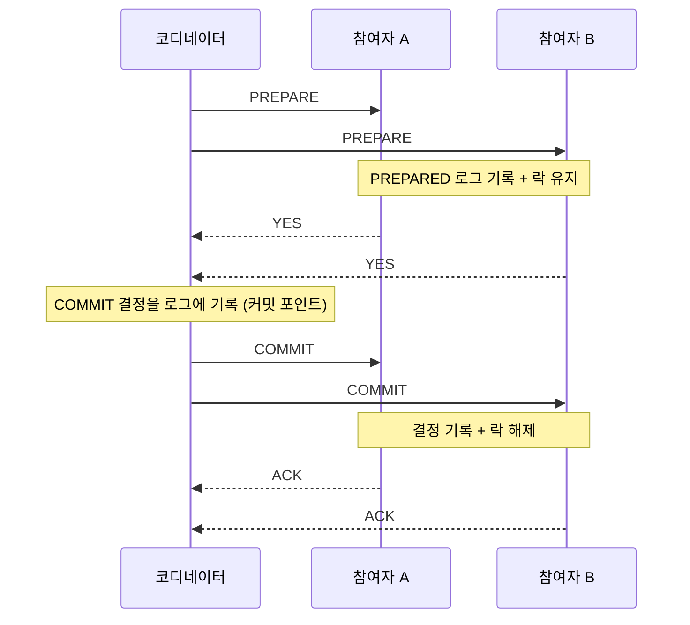
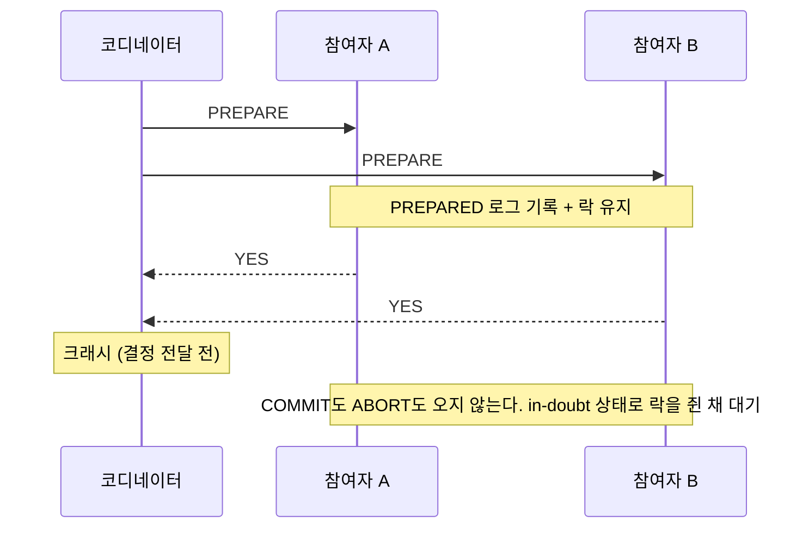

## 개요

[앞 글](/posts/cs/distributed/raft-consensus/)에서는 여러 노드가 하나의 값에 합의하는 방법을 봤다. 이번 글은 그 합의 문제의 사촌인 분산 원자적 커밋(atomic commit)을 다룬다. 여러 DB에 걸친 작업을 "전부 반영되거나 전부 취소되게" 만드는 문제다.

이 글이 답하는 질문은 두 가지다.

- 2단계 커밋(Two-Phase Commit, 2PC)은 어떻게 여러 노드의 커밋을 하나로 묶는가?
- 코디네이터가 죽으면 왜 참여자는 락을 쥔 채 기다릴 수밖에 없고, 이 문제는 어떻게 피하는가?

단일 DB 안에서 트랜잭션이 장애에도 살아남는 방법은 [WAL과 ARIES 글](/posts/cs/database/wal-aries-crash-recovery/)에서 다뤘다. 2PC는 각 노드의 로그 위에 "모두 함께 커밋할 것인가"를 정하는 단계를 하나 더 얹는다.

---

## 1. 왜 필요한가: 한쪽만 커밋되는 이체

A은행 DB에 있는 계좌에서 10,000원을 빼서 B은행 DB에 있는 계좌에 넣는 이체를 생각해 보자. 두 DB는 서로 다른 서버다. 각 DB는 자기 트랜잭션만 안다.

각자 알아서 커밋하면 이런 일이 생긴다.

1. A에서 `UPDATE`로 10,000원을 빼고 커밋한다.
2. B에 입금하려는 순간 B가 죽거나, 제약 조건에 걸려 실패한다.
3. 돈은 A에서 사라졌고 B에는 들어가지 않았다.

순서를 바꿔도 마찬가지다. 한쪽이 커밋한 뒤에는 되돌릴 수 없으므로, 나머지 쪽이 실패하면 전체가 어긋난다.

> 핵심 아이디어: 아무도 커밋하지 않은 채 "커밋할 수 있다"는 약속부터 전원에게서 받고, 전원이 약속했을 때만 커밋을 지시한다.

이 약속을 모으는 역할을 하는 노드가 코디네이터(coordinator)이고, 실제 데이터를 가진 각 DB가 참여자(participant)다. 약속을 받는 단계와 실행하는 단계, 이렇게 두 단계라서 2단계 커밋이다.

---

## 2. 정상 동작: 준비하고, 결정하고, 실행한다

과정은 세 덩어리다.

- **1단계, prepare(투표)**: 코디네이터가 모든 참여자에게 `PREPARE`를 보낸다. 참여자는 커밋에 필요한 모든 것을 로그에 디스크로 강제 기록(force write)하고, 락을 쥔 채 `YES`를 답한다. 할 수 없으면 스스로 롤백하고 `NO`를 답한다.
- **결정**: 코디네이터는 전원이 `YES`면 `COMMIT`, 한 명이라도 `NO`거나 응답이 없으면(타임아웃) `ABORT`로 정한다. 그리고 이 결정을 자기 로그에 먼저 기록한다. 이 순간이 커밋 포인트(commit point)다.
- **2단계, commit 또는 abort**: 코디네이터가 결정을 전송한다. 참여자는 결정을 로그에 기록하고 락을 풀고 `ACK`를 보낸다.



이체 예시에 시각을 붙여 보자. 이 숫자는 설명을 위한 가정이다.

| 시각 | 일어나는 일 |
| --- | --- |
| 0ms | 코디네이터가 A, B에 `PREPARE` 전송 |
| 5ms | A와 B가 각자 `PREPARED`를 로그에 기록하고 계좌 행의 락을 유지한 채 `YES` |
| 8ms | 코디네이터가 `YES` 두 개를 받고 `COMMIT`을 로그에 기록 |
| 9ms | 코디네이터가 `COMMIT` 전송 |
| 14ms | A와 B가 커밋하고 락 해제, `ACK` |

이 순서가 지켜지면 두 계좌는 함께 바뀌거나 함께 바뀌지 않는다. 문제는 8ms와 9ms 사이처럼 코디네이터가 중간에 사라지는 경우다. 그 전에, 이 프로토콜이 어떤 약속 위에 서 있는지부터 보자.

---

## 3. 두 가지 약속과 로그

2PC의 안전성은 두 가지 약속에서 나온다.

### 참여자: YES 뒤에는 마음대로 abort하지 않는다

`YES`는 "무슨 일이 있어도 커밋할 수 있다"는 약속이다. 그래서 참여자는 `YES`를 보내기 전에 변경 내용과 `PREPARED` 상태를 디스크에 남기고, 락도 계속 쥔다. 서버가 재시작돼도 이 약속을 지켜야 하기 때문이다.

만약 `YES` 뒤에 참여자가 일방적으로 abort할 수 있다면 어떻게 될까. 코디네이터가 `COMMIT`을 결정하고 B에게는 이미 전달했는데 A가 혼자 abort해 버리면, B는 커밋했고 A는 취소한 상태가 된다. 원자성이 깨진다.

### 코디네이터: 전파하기 전에 결정을 로그에 쓴다

결정이 코디네이터의 메모리에만 있다면, 전송 도중 코디네이터가 죽는 순간 결정도 사라진다. 그러면 일부 참여자는 `COMMIT`을 받았고 일부는 못 받은 상태에서 아무도 정답을 모른다.

결정을 로그에 먼저 남겨 두면 코디네이터가 재시작한 뒤에 같은 결정을 다시 알려 줄 수 있다. 이 결정이 커밋 포인트다. 이 기록이 생긴 순간부터 트랜잭션의 운명은 정해지고, 이후는 그것을 알리는 일일 뿐이다.

### 장애 시점별 복구

이 두 로그 덕분에 대부분의 장애는 로그를 읽는 것으로 복구된다.

| 장애 상황 | 복구 방법 |
| --- | --- |
| 참여자가 `PREPARE`를 받기 전에 죽음 | 투표가 오지 않아 타임아웃, 코디네이터가 `ABORT` 결정. 참여자는 아직 약속한 게 없다 |
| 참여자가 `YES` 뒤에 죽었다 재시작 | 로그에서 `PREPARED`를 발견, 코디네이터에게 결과를 물어 그대로 따른다 |
| 코디네이터가 결정을 로그에 쓴 뒤 죽었다 재시작 | 로그의 결정을 참여자에게 다시 전송 |
| 코디네이터가 결정을 쓰기 전에 죽었다 재시작 | 결정 기록이 없으므로 `ABORT`로 정리할 수 있다 |

표에서 마지막 두 줄은 코디네이터가 되살아난다는 전제다. 되살아나기 전까지 참여자는 무엇을 해야 할까. 이것이 2PC의 약점이다.

---

## 4. 코디네이터가 prepare 직후 죽으면

이체 예시를 다시 따라가되, 이번에는 5ms에 두 참여자가 `YES`를 보낸 직후, 결정이 전달되기 전에 코디네이터 서버가 죽는다.



참여자 A의 입장에서 가능한 선택지를 따져 보자.

- **스스로 abort한다**: 코디네이터가 `COMMIT`을 결정하고 B에게만 전달한 뒤 죽었을 수 있다. 그러면 B는 커밋, A는 취소가 된다.
- **스스로 commit한다**: 코디네이터가 B의 응답을 기다리다 타임아웃으로 `ABORT`를 결정했을 수 있다. 그러면 A만 커밋한 셈이다.
- **B에게 물어본다**: B도 같은 처지(in-doubt)라면 아는 게 없다. 둘이 모두 `YES`를 보냈다는 사실을 확인해도 최종 결정이 `COMMIT`인지는 알 수 없다. 결정은 코디네이터의 로그에만 있다.

세 가지 모두 막혀 있다. 이런 상태를 의심 상태(in-doubt)라고 부른다. 참여자는 결과를 모르는 채 코디네이터가 복구될 때까지 기다려야 한다.

> 결혼식 비유로 보면, 두 사람이 "예"라고 답한 직후 주례가 쓰러진 상황과 같다. 선언이 있었는지 아무도 모르니 둘 다 결혼 상태인지 아닌지 알 수 없다. 이 비유가 틀리는 점도 있다. 결혼식의 기다림은 시간 낭비일 뿐이지만, DB의 기다림은 락이라는 공유 자원을 붙잡은 채 이어져 다른 요청까지 막는다.

이렇게 코디네이터 한 대의 장애가 전체를 멈추기 때문에 2PC를 블로킹 프로토콜(blocking protocol)이라고 한다.

### 락 때문에 번지는 피해

문제는 기다리는 동안 참여자가 락을 놓지 못한다는 점이다. 앞서 `YES`의 조건이 "락을 쥐는 것"이었기 때문이다.

계좌 1번 행이 이 prepared 트랜잭션에 잠겨 있다고 하자. 이 계좌를 건드리는 다른 요청이 초당 20건 들어오면 1분에 1,200건이 줄줄이 락 대기에 걸린다. 락 대기 타임아웃이 나기 시작하고, 커넥션 풀이 대기 중인 요청으로 가득 차면 이 계좌와 관계없는 요청까지 느려진다.

게다가 prepared 상태는 로그에 영속화돼 있다. 참여자 DB를 재시작해도, 애플리케이션을 재배포해도 사라지지 않는다. 락을 쥔 세션을 찾아도 보이지 않는 이유가 이것이다. 이 트랜잭션은 더 이상 어떤 세션에도 속하지 않는다.

---

## 5. 운영에서 보이는 모습

이 현상은 실제 DB 문서에도 같은 모양으로 적혀 있다.

### PostgreSQL

`PREPARE TRANSACTION`을 실행하면 트랜잭션의 상태가 디스크에 완전히 저장되고, 세션과 분리된다. 분리된 뒤에도 트랜잭션은 그때까지 쥔 락을 계속 쥔다. 문서는 prepared 상태를 오래 방치하는 것을 경고한다. `VACUUM`이 공간을 회수하지 못하고, 극단적인 경우 트랜잭션 ID 순환(wraparound)을 막기 위해 데이터베이스가 종료될 수도 있다고 한다.

그래서 외부 트랜잭션 매니저를 두지 않았다면 `max_prepared_transactions`를 0으로 두라고 권한다. 실수로 만들어진 prepared 트랜잭션을 아무도 닫지 않는 사고를 막기 위해서다.

남아 있는 prepared 트랜잭션은 다음처럼 찾고 정리한다.

```sql
-- 남아 있는 prepared 트랜잭션 조회
SELECT gid, prepared, owner, database FROM pg_prepared_xacts;

-- 코디네이터(또는 그 로그)에서 결과를 확인한 뒤, 어느 세션에서든 종결
COMMIT PREPARED 'transfer-0001';
-- 또는
ROLLBACK PREPARED 'transfer-0001';
```

### Oracle과 MySQL

Oracle은 이 상황을 `ORA-01591: lock held by in-doubt distributed transaction`으로 보고한다. 원인은 prepared 상태의 죽은 2PC 트랜잭션이 건 락이다. 문서가 안내하는 조치는 `pending_trans$` 같은 테이블로 해당 트랜잭션을 찾고, 코디네이터와의 네트워크를 복구해 보고, 안 되면 커밋 포인트 쪽 DBA에게 올바른 결과를 물어 heuristic commit이나 abort로 로컬 부분을 종결하는 것이다.

MySQL의 XA도 같다. XA는 여러 자원(DB, 메시지 큐 등)이 하나의 분산 트랜잭션에 참여하도록 X/Open이 정한 2PC 표준 인터페이스다. `XA PREPARE`로 `PREPARED` 상태가 된 트랜잭션은 `XA RECOVER`로 목록을 보고 `XA COMMIT`이나 `XA ROLLBACK`으로 끝낸다. MySQL 8.0.29부터는 기본 설정에서 prepare 후 트랜잭션이 세션과 분리되어 다른 연결이 종결할 수 있다.

### 수동으로 끝낼 때의 원칙

세 DB의 처방은 모두 같은 순서다. 먼저 코디네이터의 결정을 확인하고, 그다음에 참여자들을 그 결정에 맞춘다.

결정을 모른 채 추측으로 한쪽을 commit하면, 코디네이터가 사실은 abort를 결정했을 때 원자성이 깨진다. 이렇게 사람이 개입해 결과를 강제하는 것을 heuristic 결정이라고 하며, 락을 풀 수 있는 대신 불일치의 위험을 사람이 떠안는다. 재발 방지에는 코디네이터 복구 절차와 오래된 prepared 트랜잭션을 감시하는 알림이 필요하다.

---

## 6. 장애가 없어도 비싸다

블로킹은 장애 때의 문제지만, 2PC는 평소에도 비용을 낸다.

- 참여자가 n명이면 메시지는 `PREPARE`, 투표, 결정, `ACK`로 대략 4n개다.
- 로그 강제 기록이 코디네이터 쪽과 참여자 쪽 모두에 필요하다.
- 전체 속도는 가장 느린 참여자가 정한다. 코디네이터는 모든 투표가 모일 때까지 기다린다.
- 그 사이 참여자는 락을 쥐고 있다. 락 보유 시간이 왕복 2번과 로그 쓰기 몇 번만큼 늘어난다.

락 보유 시간이 왜 중요한지는 같은 행을 반복해서 바꾸는 경우로 보면 알 수 있다. 같은 행의 쓰기는 앞 트랜잭션이 락을 풀어야 시작하므로, 처리량의 상한이 대략 1 나누기 락 보유 시간이다.

다음은 가정한 숫자다.

| 환경 | 왕복(RTT) | 로그 쓰기 | 락 보유 시간 | 같은 행의 최대 처리량 |
| --- | --- | --- | --- | --- |
| 같은 데이터센터 | 1ms | 2ms 3번 | 약 8ms | 약 125건/초 |
| 대륙 간 | 100ms | 2ms 3번 | 약 206ms | 약 5건/초 |

핫스팟이 되는 행(인기 상품의 재고, 특정 계좌)에 2PC를 쓰면 지리적 거리만큼 직접 느려진다. 그래서 "정합성은 필요하지만 장기 락은 못 쥔다"는 상황에서 대안이 필요해진다.

---

## 7. 블로킹을 피하는 대안

대안은 두 방향이다. 하나는 2PC의 코디네이터 문제를 고치는 것이고, 다른 하나는 아예 분산 락을 쓰지 않는 것이다.

### 3PC: 한 단계를 더 넣는다

3단계 커밋(Three-Phase Commit, 3PC)은 투표와 커밋 사이에 사전 커밋(pre-commit) 단계를 더 넣어 블로킹을 줄인다. 하지만 네트워크 지연과 노드 응답 시간에 상한이 있다는 가정이 필요하다. 지연이 무한할 수 있고 프로세스가 멈출 수 있는 실제 환경에서는 원자성을 보장하지 못하고, 왕복도 늘어난다. 그래서 실무에서는 거의 쓰이지 않는다.

### 합의 기반 커밋: 코디네이터와 참여자를 복제한다

Gray와 Lamport의 Paxos Commit은 각 참여자의 commit/abort 결정을 Paxos 합의로 기록한다. 코디네이터 역할을 2F+1개 노드에 나눠 맡기고, 그중 F+1개만 살아 있으면 진행한다. 논문은 고전 2PC가 이 알고리즘에서 F=0인 특수한 경우, 곧 장애를 하나도 견디지 못하는 형태라고 설명한다. 장애가 없을 때의 비용은 메시지 지연 한 번이 더 드는 정도이고, 디스크 기록 지연은 2PC와 같다고 한다.

Spanner가 이 방향의 대표 사례다. 각 데이터 조각은 Paxos 그룹으로 복제되고, 여러 그룹에 걸친 트랜잭션은 그 위에서 2PC를 한다. 논문에 따르면 참여자 리더는 prepare 레코드를, 코디네이터 리더는 commit 레코드를 Paxos로 기록한다. 리더 한 대가 죽어도 로그가 복제돼 있으므로 다른 복제본이 이어받을 수 있고, 논문은 이것이 2PC의 가용성 문제를 완화한다고 쓴다. [Raft 글](/posts/cs/distributed/raft-consensus/)의 리더 교체와 로그 복제가 같은 역할을 한다고 보면 된다.

다만 "완화"이지 "제거"는 아니다. 그룹의 과반이 함께 죽으면 여전히 멈춘다. 대신 복제 비용과 구현 복잡도, 지연이 늘어난다.

### Saga: 락을 오래 쥐지 않는다

주문, 결제, 재고처럼 서로 다른 서비스가 각자의 DB를 가지는 마이크로서비스에서는 2PC를 쓰기 어렵다. DB들이 XA 같은 프로토콜을 지원하지 않을 수도 있고, 팀과 배포가 다르며, 락을 서비스 경계 너머로 오래 쥐면 가용성과 처리량이 무너진다.

Saga는 단계마다 로컬 트랜잭션을 커밋하고, 뒷단계가 실패하면 앞단계를 취소하는 보상 트랜잭션(compensating transaction)을 실행한다. 락을 오래 쥐지 않으므로 확장성이 좋다. 대가도 분명하다.

- 격리가 없다. 보상되기 전의 중간 상태가 외부에 보인다.
- 보상 로직은 직접 설계해야 한다. 결제 승인을 취소하는 일처럼 항상 뒤집을 수 있는 건 아니다.
- 메시지가 중복되거나 순서가 바뀌어도 맞게 동작하도록 각 단계를 멱등하게 만들어야 한다. 이는 [멱등성 글](/posts/cs/distributed/idempotency-exactly-once/)에서 다룬다.

### outbox: DB 변경과 메시지 발행을 로컬 트랜잭션 하나로

Saga나 이벤트 기반 구조에서 흔한 사고는 "DB는 커밋됐는데 메시지는 못 나갔다"이다. DB와 메시지 브로커라는 두 시스템에 쓰므로 2PC가 필요해 보이지만, outbox 패턴은 이를 피한다.

비즈니스 데이터를 바꾸는 같은 로컬 트랜잭션 안에서 발행할 이벤트를 `outbox` 테이블에 행으로 함께 저장한다. 커밋되면 둘이 같이 남고 롤백되면 둘이 같이 사라진다. 별도 프로세스가 이 테이블을 읽어 브로커로 보내며, 전송이 실패하면 다시 시도하므로 메시지는 최소 한 번(at-least-once) 간다. 수신자는 중복을 견뎌야 한다.

스프링에서 커밋 뒤에 리스너를 실행하는 `AFTER_COMMIT` 방식은 커밋과 발행 사이의 틈이 남는다. 리스너가 실패해도 호출자는 모르는 문제는 [@TransactionalEventListener(AFTER_COMMIT) 글](/posts/dev/backend/transactional-event-listener-after-commit/)에서 자세히 다뤘다. outbox는 그 틈을 데이터로 메우는 방법이다.

### 비교

| 방식 | 원리 | 얻는 것 | 잃는 것 |
| --- | --- | --- | --- |
| 2PC | 준비 후 결정, 락 유지 | 강한 원자성과 격리 | 코디네이터 장애 시 블로킹, 지연과 락 보유 시간 증가 |
| 3PC | 사전 커밋 단계 추가 | 동기 시스템 가정에서 블로킹 완화 | 왕복 증가, 현실의 파티션에서는 안전하지 않다 |
| 합의 기반 커밋 | 코디네이터와 참여자 상태를 복제 | 블로킹 크게 완화 | 구현 복잡도, 지연과 비용 |
| Saga | 로컬 커밋과 보상 트랜잭션 | 긴 락이 없다, 확장성 | 격리 없음, 보상과 멱등성 직접 설계 |
| outbox | 이벤트를 같은 로컬 트랜잭션에 저장 | DB 변경과 발행의 원자성 | 최소 한 번 전달, 수신자 멱등성 필요 |

선택 기준은 이렇다. 같은 조직의 DB 몇 개 안에서 강한 정합성이 필요하고 락 시간을 감당할 수 있으면 2PC나 합의 기반 커밋을 쓴다. 서비스 경계를 넘고 최종 일관성으로 충분하면 Saga와 outbox를 쓴다.

---

## 결론

- 2PC는 "먼저 전원의 커밋 약속을 받고, 그다음 결정을 내려 알린다"는 두 단계로 여러 노드의 커밋을 하나로 묶는다. 원자성은 YES 뒤에는 abort하지 않는다는 약속과 결정을 로그에 먼저 쓴다는 규칙에서 나온다.
- 같은 약속 때문에 코디네이터가 결정을 알리기 전에 죽으면 참여자는 in-doubt 상태에서 락을 쥔 채 기다려야 한다. 결정은 코디네이터의 로그에만 있기 때문이다. 이것이 "블로킹 프로토콜"의 의미다.
- 운영에서는 재시작해도 풀리지 않는 락 대기로 보인다. PostgreSQL은 `pg_prepared_xacts`, MySQL은 `XA RECOVER`, Oracle은 `pending_trans$`로 찾고, 코디네이터의 결정을 확인한 뒤 종결한다.
- 장애가 없어도 락 보유 시간이 늘어 핫스팟 행의 처리량이 떨어진다.
- 블로킹은 코디네이터를 합의로 복제해 완화하거나(Paxos Commit, Spanner), 락을 쓰지 않는 Saga와 outbox로 피한다. 선택은 정합성의 강도와 서비스 경계에서 결정된다.

---

## 출처

- [PostgreSQL 공식 문서: PREPARE TRANSACTION](https://www.postgresql.org/docs/current/sql-prepare-transaction.html)
- [PostgreSQL 공식 문서: pg_prepared_xacts](https://www.postgresql.org/docs/current/view-pg-prepared-xacts.html)
- [Oracle Database Error Help: ORA-01591](https://docs.oracle.com/en/error-help/db/ora-01591/)
- [MySQL 8.0 Reference Manual: XA Transaction States](https://dev.mysql.com/doc/refman/8.0/en/xa-states.html)
- [Gray, Lamport, Consensus on Transaction Commit (Microsoft Research)](https://www.microsoft.com/en-us/research/publication/consensus-on-transaction-commit/), [arXiv 초록](https://arxiv.org/abs/cs/0408036)
- [Corbett et al., Spanner: Google's Globally-Distributed Database (OSDI 2012)](https://static.googleusercontent.com/media/research.google.com/en//archive/spanner-osdi2012.pdf)
- [Wikipedia: Two-phase commit protocol](https://en.wikipedia.org/wiki/Two-phase_commit_protocol)
- [Wikipedia: Three-phase commit protocol](https://en.wikipedia.org/wiki/Three-phase_commit_protocol)
